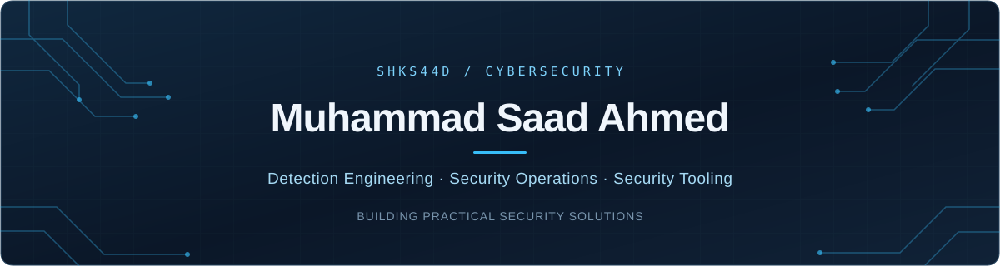

  

I build practical tools for threat detection, investigation, and security assessment.

  
  

## Currently building

**[Socluma](https://github.com/ShkS44D/Socluma)** — a personal security operations platform that brings telemetry, threat detection, incident investigation, and evidence-grounded AI assistance together.

My focus is on making security signals easier to investigate and turning findings into clear, actionable evidence.

## Featured projects

| Project | What I'm building |
| :--- | :--- |
| **[Socluma](https://github.com/ShkS44D/Socluma)** | AI-assisted security operations for collecting telemetry, detecting threats, and investigating incidents. |
| **[SafeScan](https://github.com/ShkS44D/SafeScan)** | Network exposure assessment with TCP port scanning and banner-based service identification. |
| **[Contract-Radar](https://github.com/ShkS44D/Contract-Radar)** | Smart contract security scanning through static analysis. |

## Focus & tools

| Area | Interests & tools |
| :--- | :--- |
| **Detection & investigation** | Threat detection · SIEM operations · Incident response · Wireshark |
| **Security assessment** | Network defence · Web application security · Smart contract security · Burp Suite · Kali Linux |
| **Development** | Python · Docker · Security automation |

## Background

- **Education:** BS Cybersecurity at CASE Sir Syed, Islamabad.
- **Experience:** Internships at Askari Bank (SIEM operations) and KaiRiz Cyber Technology.
- **Certifications:** Junior Penetration Tester (TryHackMe) · ICIP (OPSWAT).

---

  Interested in detection engineering, security tooling, or a project collaboration? 
  <a href="https://www.linkedin.com/in/shsaadahmed/">Let's connect on LinkedIn</a>.

